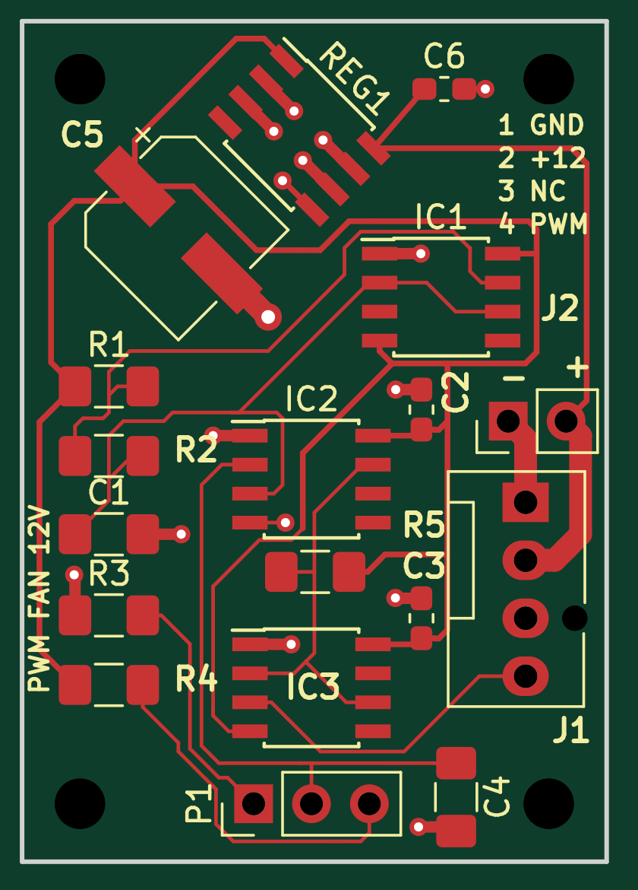

# Fan controller — repaired 12 V candidate

Generated 2026-10-22 from the editable KiCad 10 project in the parent directory.

**Native ERC and DRC pass. This is a review candidate, not an approved manufacturing release.** The aggregate MCP project gate still reports FAIL; its exact output and the geometric investigation are included. No order has been placed and these revised files have not been uploaded to JLCPCB.

## Verified results

| Check | Result |
| --- | --- |
| Native KiCad 10.0.6 ERC | 0 findings |
| Native DRC, including warnings | 0 findings |
| Unconnected items | 0 |
| Native courtyard violations | 0 |
| Schematic named pad nets transferred | 63/63 |
| Schematic/PCB footprint references | 22/22 |
| Assembly BOM / CPL | Same 15 SMT references; 11 BOM rows |
| Copper / nominal thickness | 2 layers / 1.6 mm |
| Board outline | 25.654 × 36.830 mm |
| Minimum routed width / via drill | 0.160 / 0.399 mm |

Existing project/default ignored checks are listed in the raw native reports. This repair added no exclusions or relaxed severities.

## Changes from the historical quote

- Corrected C2/C4 orientation and exact library footprint geometry; removed dangling and zero-length tracks.
- Replaced imported silk with native markings, readable references, input polarity and **12 V** identification. Pin-1 and C5 polarity markings remain.
- Added **C6, 100 nF / 25 V**, between REG1 input and ground, following the KF50 input-bypass application guidance. It shares part C2167748 with C2/C3. Assembly increases from 14 to **15 SMT parts per board**.
- Retained approved stocked 12 V substitutions. KF50BD-TR's 20 V maximum input means the original 12–28 V marking does not apply. [ST datasheet](https://www.st.com/resource/en/datasheet/kfxx.pdf).

## Files to use for a revised JLCPCB quote

1. `fancontroller_12v_gerbers_DRAFT.zip` — repaired Gerbers and Excellon drill data; includes top/bottom copper, masks, paste, silkscreen and outline. The drill file encodes plated/nonplated tools using Excellon attributes.
2. `BOM.csv` — JLCPCB assembly BOM, 11 rows covering 15 SMT parts. **Do not regenerate lowercase `bom.csv` into this directory on a case-insensitive Mac: it would overwrite this vendor BOM.**
3. `CPL.csv` — JLCPCB placement, Top, millimeters, original absolute Gerber frame with negative Y. Angles normalized to 0–360° after the MCP SOIC correction.

Quote scope: **5 PCBs, top-side SMT assembly**, green mask and white silk. P1, J1 and J2 are for hand assembly; H1–H4 are mechanical holes. For the separate bare-board option, request one **150 × 150 mm frameless top-side solder-paste stencil**, then save the quote in JLCPCB. No price for this revised design has been obtained.

Historical root BOM workbook, root draft position CSV and everything under `JLCPCB_Quote/` predate C6 and final placement repairs. They are superseded for manufacturing by this directory. Preserve them as sourcing/quote history.

## Remaining review and tool findings

- `project_quality_gate.json` is **FAIL**, not waived. Connectivity flags are the four pinless mechanical mounting-hole symbols, which intentionally have no electrical nets.
- The MCP placement checker uses unrotated footprint width/height centered on each footprint origin. It flags eight pairs and J1/P1 outside the board. `placement_geometry_review.json` instead transforms all **22** actual courtyard polygons by their saved rotation and offset: **no overlaps**, all courtyards present. Gaps for the eight flagged pairs range from 0.036 to 0.966 mm. J1/P1 are inside the board. J2's courtyard extends **0.006 mm** past the outline; native copper edge clearance passes. This audit verifies library geometry, not actual purchased parts or mating cables.
- Native DFM checks pass their seven measured criteria but retain a generic manual-review warning. Live tool evidence is in `../recovery/final_drc_repair/fan-release-validate.log`. The DFM layer-count helper reports three layers incorrectly; the saved board and Gerber set contain **F.Cu and B.Cu only**. Its stackup helper likewise counts surface layers toward thickness; the board's native thickness is 1.6 mm.
- `schematic.pdf` is a **working drawing** with text overlaps; cosmetic score 32/100. The native schematic and netlist remain electrically checked. This is an advisory readability limitation.
- Confirm the actual hand-assembled connectors, mating clearance and potentiometer wiring. J1 is the official KiCad Molex-compatible fan header; J2 is a standard 2.54 mm two-pin header; P1 is a header for an external potentiometer.
- Inspect JLCPCB's newly matched 15-part placement preview, especially IC pin 1, C5 polarity and capacitor rotations. Refresh stock and sourcing. C5 retains the previously disclosed 2000 h at 105°C rating versus the original 5000 h.
- No bench test or simulation has been performed. Obtain vendor DFM and human engineering review before ordering.

## Evidence

- `erc_report.json`, `drc_report.json`: latest native reports.
- `project_quality_gate.json`: full aggregate result; `validation_summary.json`: compact status and limitations.
- `pcb_quality_gate.json`, `dfm_profile_check.json`: native DRC reports generated by those gate calls, not standalone aggregate summaries.
- `assembly_audit.json`: reference-set and rotation audit.
- `positions-kicad-mm.csv`: original native millimeter export; `positions-jlcpcb-corrected.csv`: MCP correction output before final vendor formatting.
- `netlist.net`: exported circuit connectivity.
- `board_preview.png`: inspected 2D copper/silkscreen/outline composite; `board.pdf`: native board plot.
- `SHA256SUMS`: artifact and source checksums. This manifest is for reproducibility, not approval.

